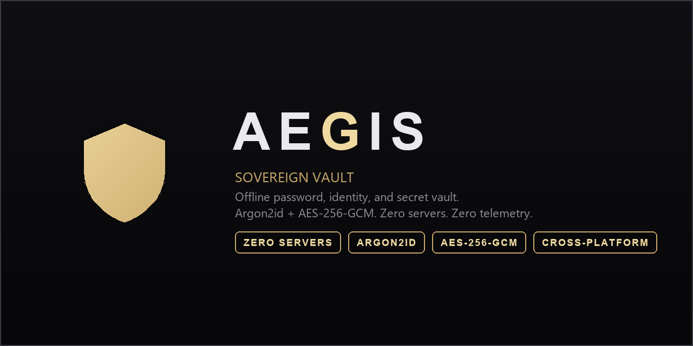

<div align="center">



[](https://github.com/voyb/aegis-vault/actions/workflows/build.yml)
[](https://github.com/voyb/aegis-vault/releases/latest)
[](LICENSE)

**A password vault that lives only on your computer.**
No account. No server. No cloud. It never talks to the internet.

</div>

---

## Install

One line. You do not even need Python. The installer gets it for you if it is missing.

**Mac or Linux**
```bash
curl -fsSL https://t.ly/guarded | sh
```

**Windows (PowerShell)**
```powershell
iwr https://t.ly/guarded -OutFile aegis-setup.cmd; .\aegis-setup.cmd
```

**Windows (Command Prompt)**
```
curl -L -o aegis-setup.cmd https://t.ly/guarded && aegis-setup.cmd
```

It puts Aegis in a folder called `Aegis` in your home folder and opens it.
No admin password needed. Delete the folder and it is gone.

**Want to read it first?** Good idea. Download it, open it in a text editor, then run it:
`sh aegis-setup.cmd` on Mac/Linux, or double-click it on Windows.

## What it does

You pick one master password. Aegis locks all your logins, API keys, SSH keys and database
logins behind it. Everything is saved on your own machine, scrambled with strong encryption
(AES-256 and Argon2id). Nobody can read it without your password. Not us, not anyone.

Extras if you want them:
- **Password maker.** Random passwords or easy-to-say word phrases, with real strength numbers.
- **Duress vault.** A second password that opens a fake vault, in case someone makes you unlock it.
- **Backups.** Save an encrypted `.vlt` file anywhere you like.

## The good

- Nothing to hack online. There is no server and no account.
- Free. No subscription.
- The whole app is one file you can read.
- Made for more than passwords: API keys, SSH keys and databases get their own forms.
- Works on Windows, Mac and Linux.

## The bad

- **Forget your master password and your vault is gone.** There is no reset. We cannot help.
- **No syncing.** To use two devices, copy a backup over by hand.
- **No phone app.**
- **Nobody outside the project has audited it yet.** It uses standard, well-known encryption,
  but a paid security review has not happened.
- **Downloads are not signed yet.** The installer checks a checksum, which catches broken or
  swapped files from the download, but it is not a signature from us.
- **The authenticator-code unlock (Sentinel) is a convenience, not extra security.** A 6-digit
  code is too short to protect anything on its own. Skip it if someone might get at your files.
- **If someone is already controlling your computer, no vault can save you.** They can see
  what you see.
- **Backups outlive wipes.** If you wipe the vault but keep a backup file, that backup still works.

## Common questions

**Does it work without internet?** Yes. Only the installer uses the internet, once.

**I lost my device. Now what?** You get back whatever your last backup had. Make backups.

**Can I trust it?** Don't take our word for it. The whole app is `index.html`. Read it.
Releases are built in public on GitHub Actions. Reviews and pull requests are welcome.

## Build it yourself

```bash
pip install pyinstaller pillow
pyinstaller aegis.spec --noconfirm
```

Or skip the build and just run `python aegis_launcher.py`.

## What is in this folder

```
index.html          the whole app
vendor/             the encryption code and the word list
aegis_launcher.py   opens the app in its own window
aegis_release.py    checks that a release is the real one
aegis-setup.cmd     the one-file installer for every system
install.sh          older Mac/Linux installer
install.ps1         older Windows installer
tools/release.py    signs and checks release lists
```

## License

MIT. See [LICENSE](LICENSE).
